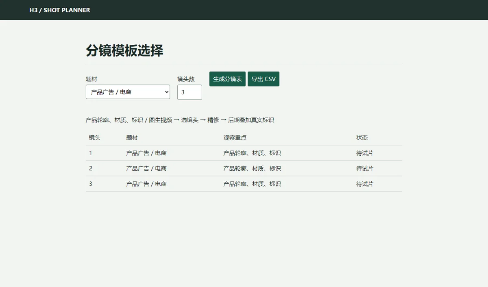
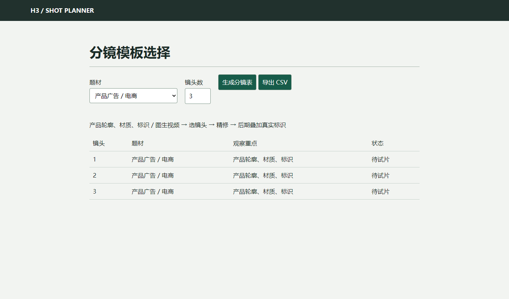
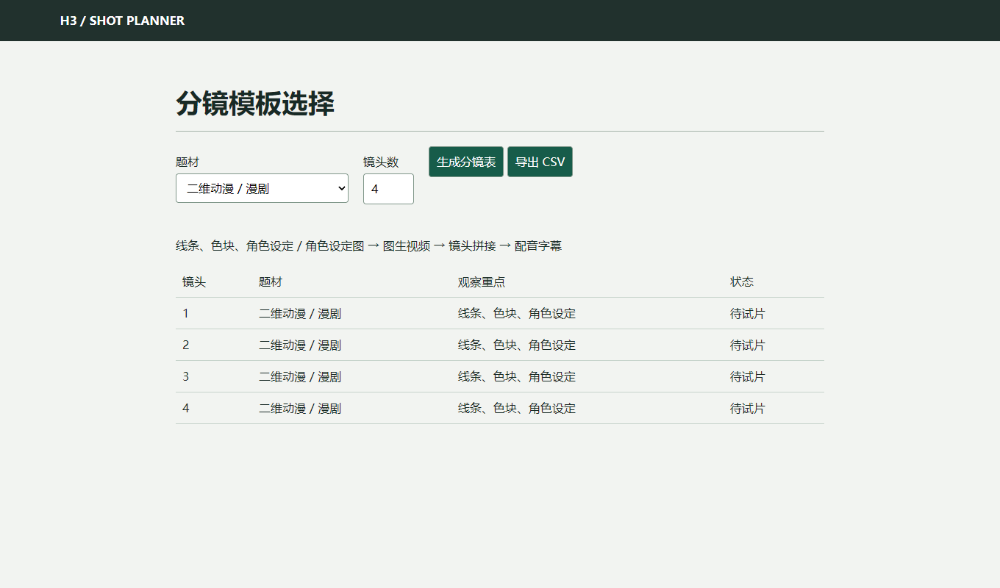

# H3 镜头策划器

从本地 MiniMax H3 制作工具包抽出原有 14 类题材模板与分镜表，提供无模型、无依赖的镜头规划页面。

## 实际界面巡览



上图由两张本次实际运行画面的截屏轮换组成，不是连续操作录像。

| 题材模板与初始计划 | 四镜头规划示例 |
| --- | --- |
|  |  |

## 可以做什么

- 选择题材并看观察重点
- 设置镜头数，生成可读分镜表
- 导出 CSV 供拍摄或下一阶段生成使用

## 本地运行

```sh
python -m http.server 8000 --bind 127.0.0.1
```

在浏览器打开 `http://127.0.0.1:8000/`。只监听本机；不执行部署。

## 实测与范围

14 种模板可选；实测生成四镜头表并导出 CSV。

这是 H3 工具包的前期策划组件，不是模型、视频生成后端或完整精修管线。不包含模型权重和样片版权。

[手机宽度实机截屏（390 px）](showcase/03-mobile.png) · [授权范围](LICENSE) · [来源与署名](NOTICE.md)
